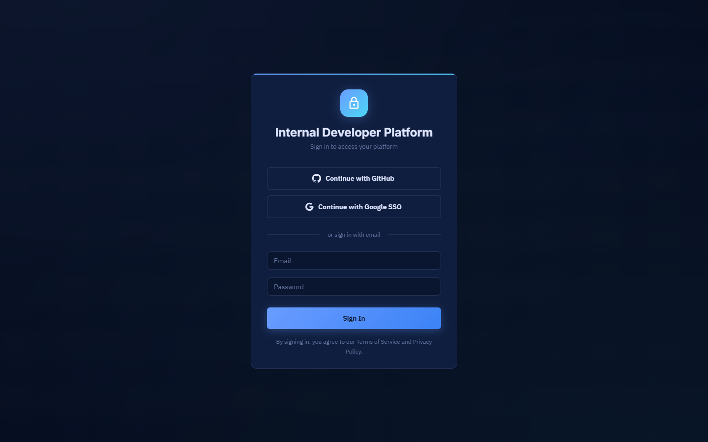
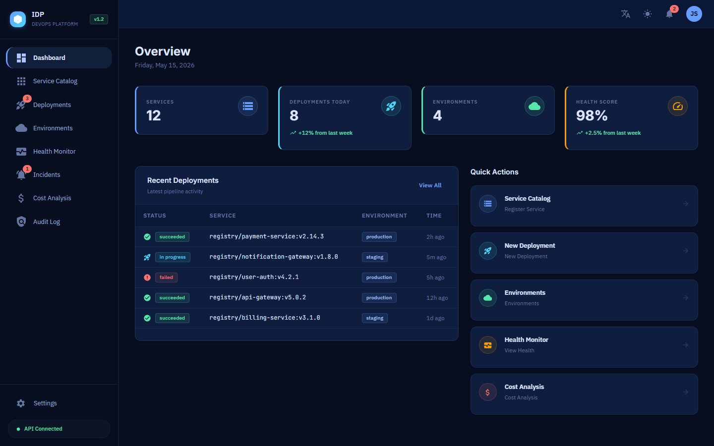
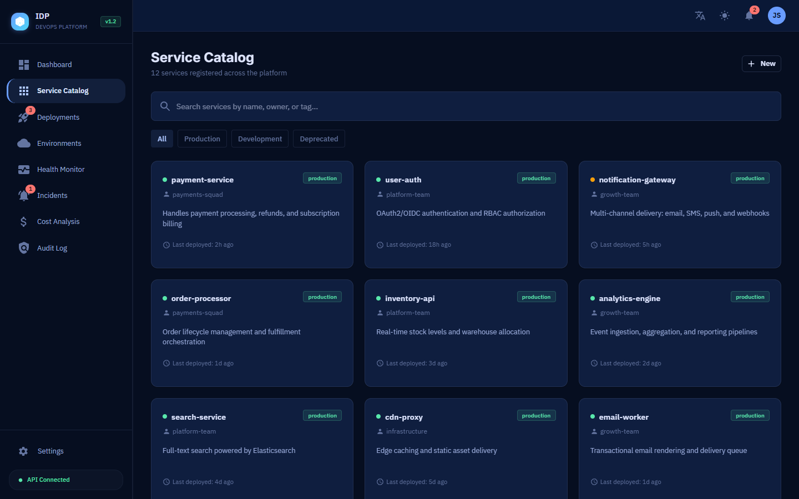
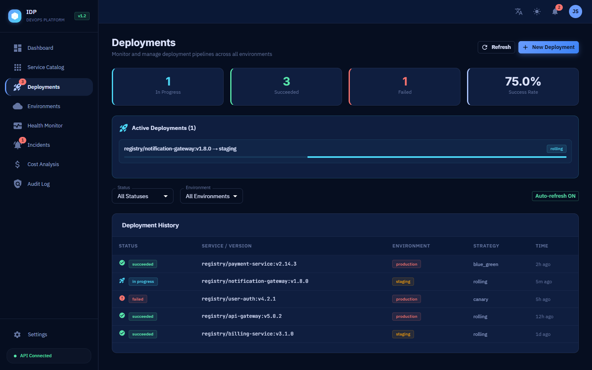
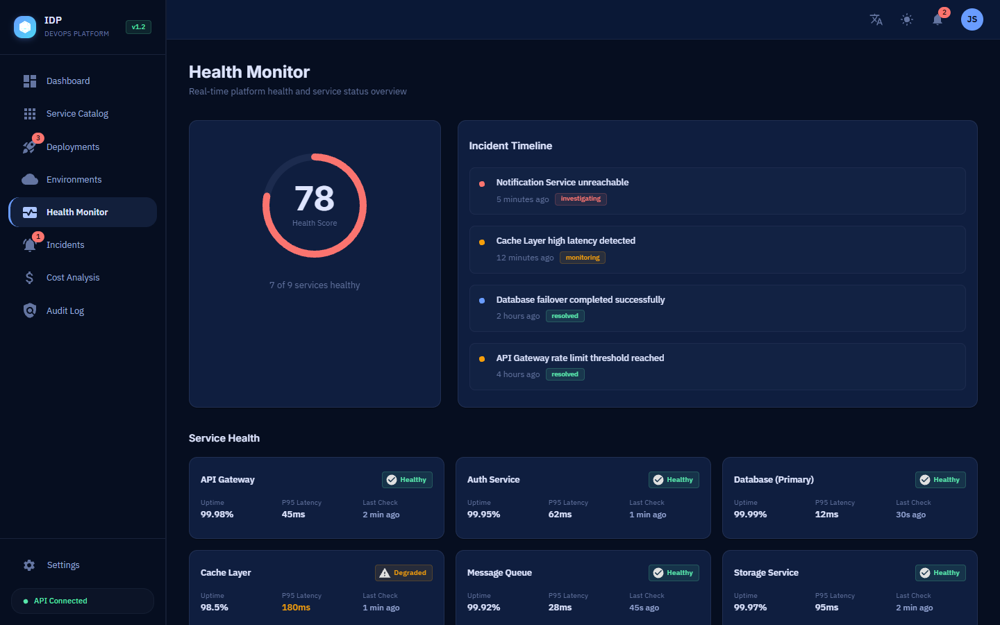
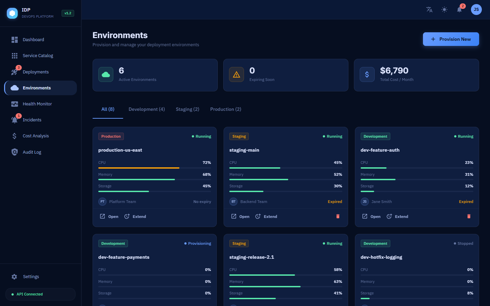
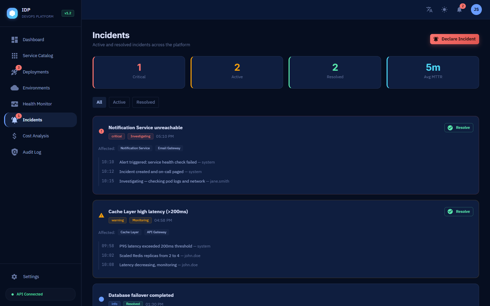
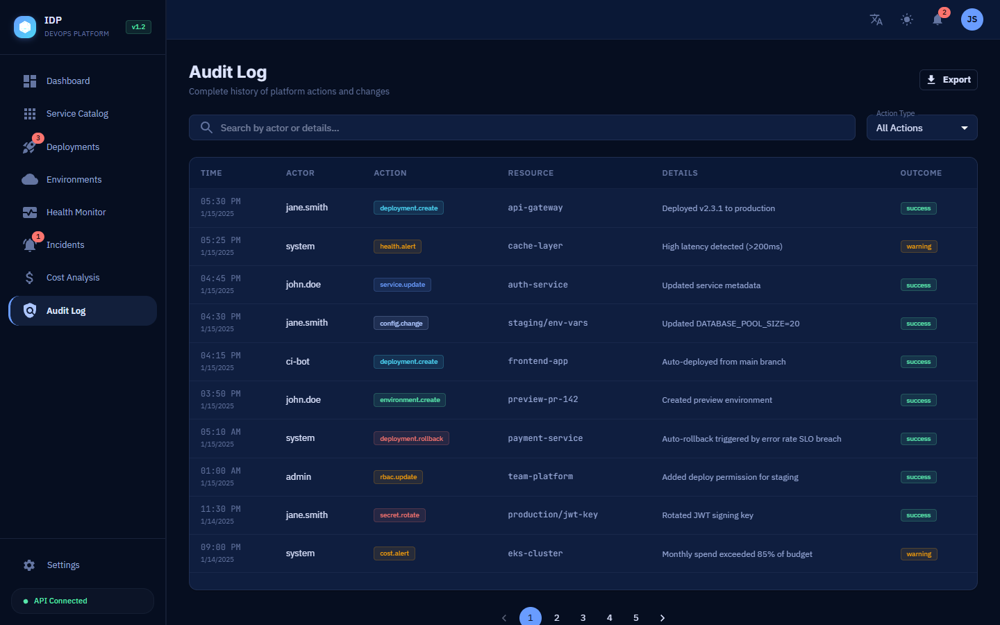
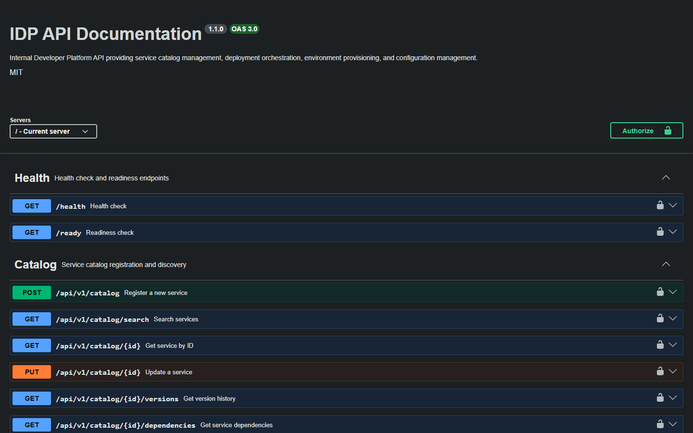

# Internal Developer Platform

## Overview

I built an Internal Developer Platform (IDP) that brings infrastructure management, application deployments, and development environments into one centralized portal.

The goal of this project was to simplify common DevOps tasks by giving developers a self-service interface to manage services, provision infrastructure, and monitor deployments without having to work with each tool separately.

I used React and Node.js to build the application, with Terraform, Kubernetes, and ArgoCD supporting infrastructure provisioning and deployment workflows.

### Key Highlights

- Built a developer portal with a service catalog, deployment management, and environment monitoring.
- Created 10 Terraform modules for AWS infrastructure, including EKS, RDS, ElastiCache, and VPC.
- Set up 14 GitHub Actions workflows for CI/CD, automated testing, security scanning, and compliance.
- Integrated Kubernetes, Istio, and Flagger for container orchestration, traffic management, and canary deployments.
- Used NATS JetStream for event-driven messaging and deployment notifications.
- Organized the project as a monorepo using Turborepo and pnpm.

## Portal Preview

The portal provides a central place to view services, manage deployments, monitor application health, and track incidents.

| Login | Dashboard | Service Catalog |
| :---: | :---: | :---: |
|  |  |  |

| Deployments | Health Monitoring | Environments |
| :---: | :---: | :---: |
|  |  |  |

| Incidents | Audit Log | API Documentation |
| :---: | :---: | :---: |
|  |  |  |

## Architecture

I designed the platform around a few main components:

- **Frontend:** A React-based developer portal where users can access platform features.
- **Backend:** A Node.js API gateway that handles authentication, permissions, requests, and audit logging.
- **Platform Services:** Separate services for the service catalog, infrastructure provisioning, deployments, and configuration management.
- **Infrastructure:** Terraform and Kubernetes manage infrastructure and containerized applications, while ArgoCD handles GitOps-based deployments.
- **Data and Messaging:** PostgreSQL stores application data, Redis supports caching and job queues, and NATS JetStream handles asynchronous events.
- **Monitoring:** Prometheus, Grafana, Loki, and Jaeger support metrics, logging, and distributed tracing.

## Features

| Area | Functionality |
|---|---|
| **Developer Portal** | Centralized dashboard, service catalog, and deployment management |
| **Infrastructure Provisioning** | Terraform modules for AWS resource provisioning |
| **Container Orchestration** | Kubernetes-based application management |
| **CI/CD Automation** | GitHub Actions workflows for building, testing, and deployment |
| **GitOps** | ArgoCD for managing application deployments |
| **Deployment Strategies** | Canary deployments and automated health checks using Flagger |
| **Security** | Role-based access control, audit logging, and vulnerability scanning |
| **Monitoring** | Metrics, dashboards, centralized logging, and distributed tracing |
| **Notifications** | Real-time updates and event-driven messaging |
| **Environment Management** | Separate development, staging, and production configurations |

## Tech Stack

| Layer | Technologies |
|---|---|
| Frontend | React, TypeScript, Vite |
| Backend | Node.js, Express, TypeScript |
| Database | PostgreSQL |
| Caching & Queues | Redis, BullMQ |
| Event Messaging | NATS JetStream |
| Infrastructure as Code | Terraform |
| Containerization & Orchestration | Docker, Kubernetes, AWS EKS |
| Service Mesh | Istio |
| GitOps | ArgoCD |
| CI/CD | GitHub Actions |
| Monitoring & Logging | Prometheus, Grafana, Loki, Jaeger |
| Security | Trivy, Snyk, CodeQL |
| Monorepo | Turborepo, pnpm |
| Testing | Vitest, Playwright |

## Project Structure

```text
├── apps/
│   ├── api/              # Node.js backend
│   └── portal/           # React frontend
├── packages/
│   ├── shared/           # Shared utilities and types
│   ├── ui/               # Reusable UI components
│   ├── cli/              # Platform CLI
│   └── config/           # Shared configurations
├── infra/
│   ├── terraform/        # AWS infrastructure modules
│   ├── kubernetes/       # Kubernetes manifests
│   ├── argocd/           # GitOps configurations
│   ├── istio/            # Service mesh configurations
│   ├── flagger/          # Canary deployment configuration
│   ├── chaos/            # Chaos engineering
│   └── monitoring/       # Monitoring configurations
├── docs/                 # Project documentation
├── scripts/              # Automation scripts
└── .github/
    └── workflows/        # GitHub Actions workflows
```
