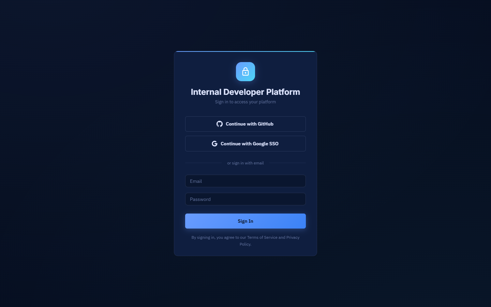
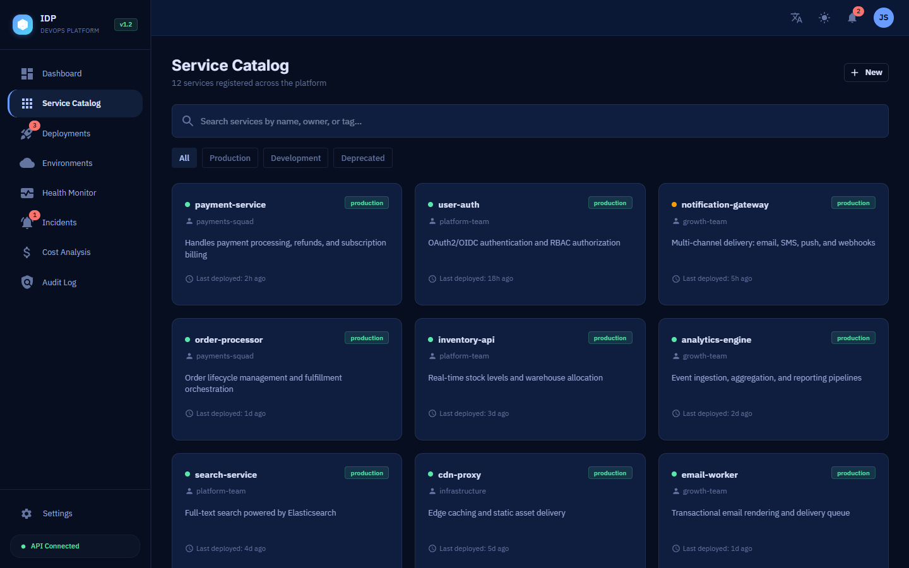
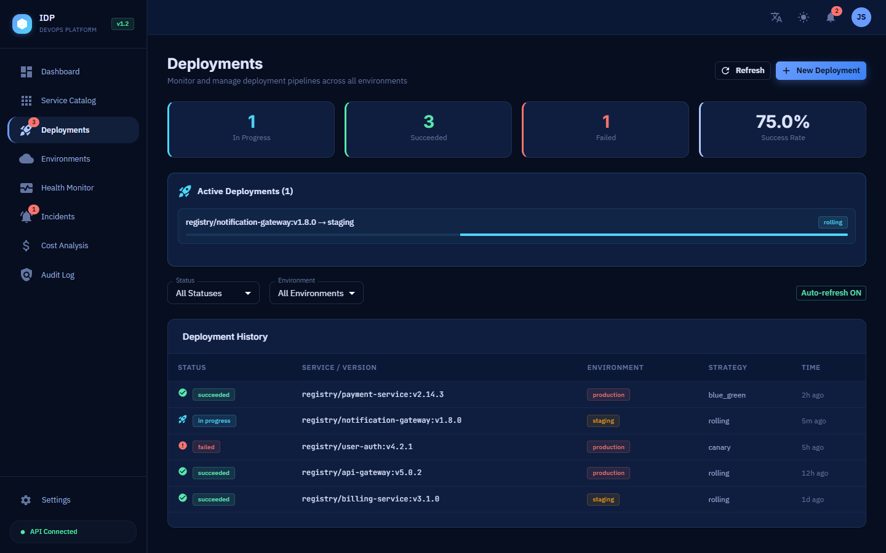
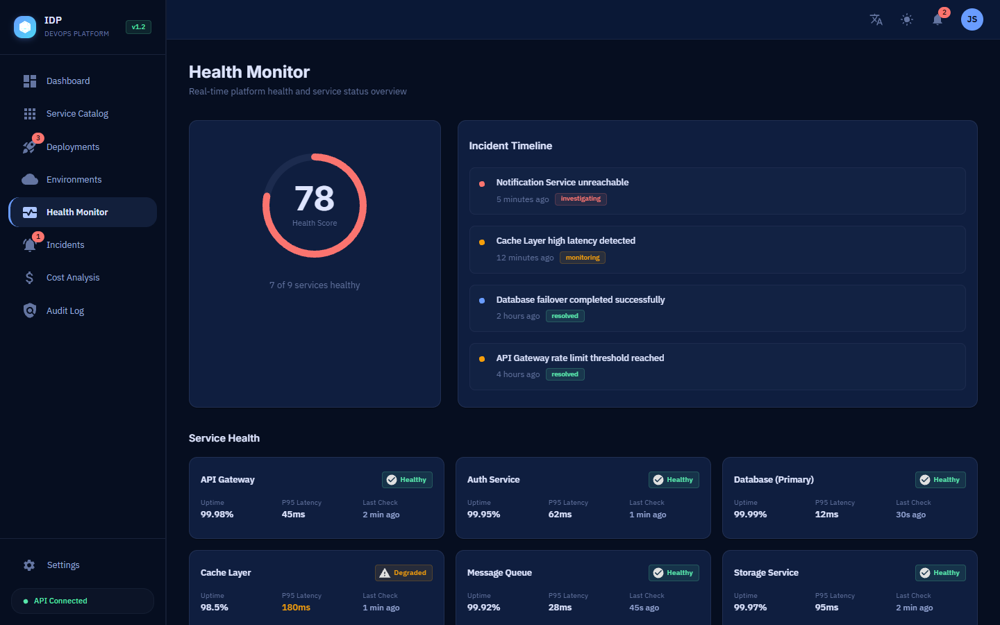
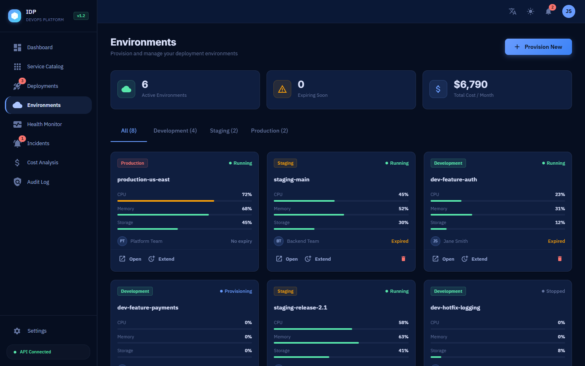
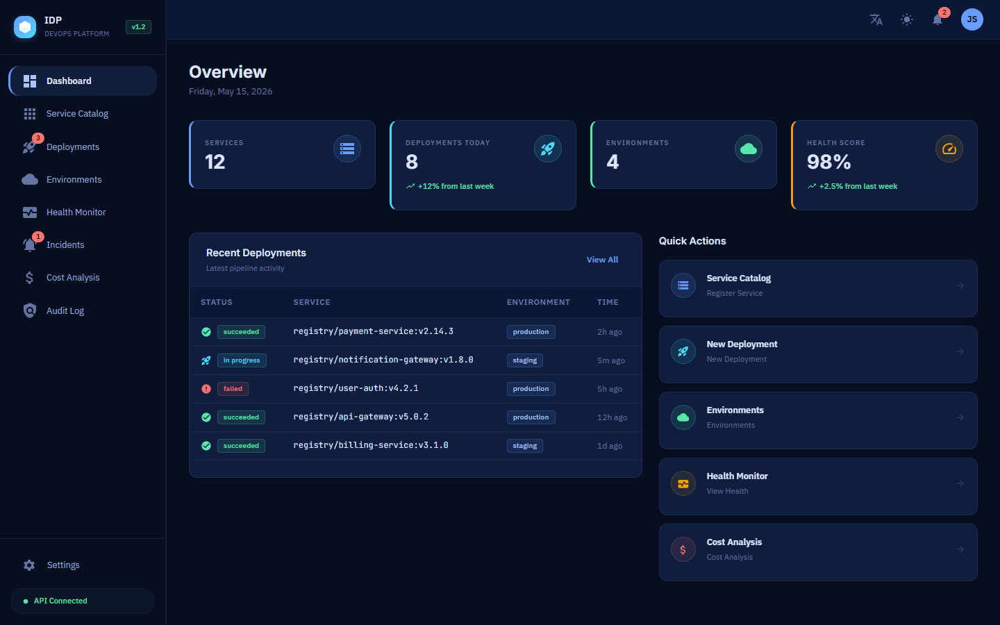
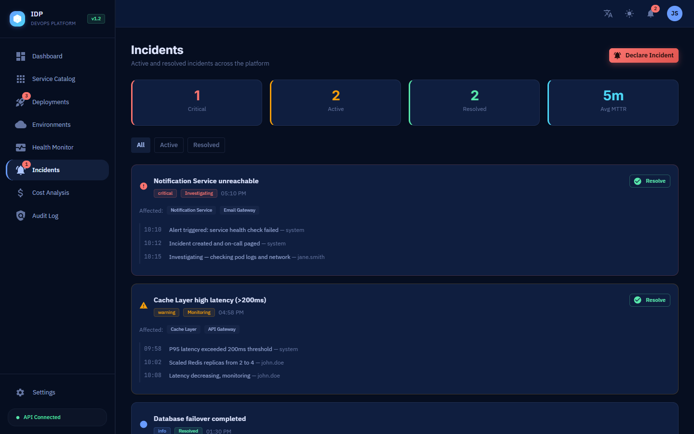
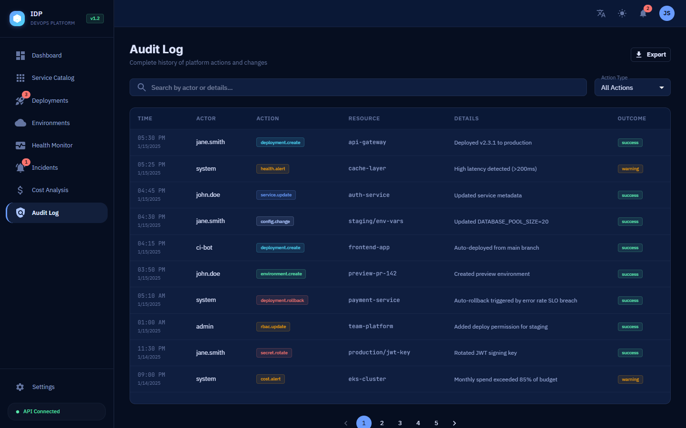
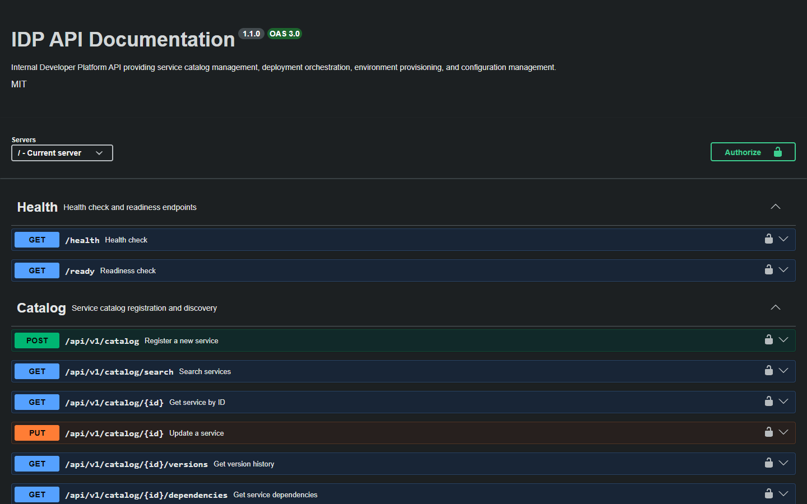

# Internal Developer Platform (IDP)


## Overview

A production-ready Internal Developer Platform that enables engineering teams to self-service infrastructure provisioning, application deployments, and environment management through a unified portal. Built with cloud-native principles, GitOps workflows, and enterprise security patterns.


### Key Highlights

- **14 GitHub Actions workflows** covering CI, CD, security scanning, and compliance
- **10 Terraform modules** for AWS infrastructure provisioning (EKS, RDS, ElastiCache, VPC)
- **Full Kubernetes stack** with Istio service mesh, Flagger canary deployments, and chaos engineering
- **Event-driven architecture** using NATS JetStream for real-time deployment notifications
- **Comprehensive documentation** including ADRs, runbooks, SLOs, and onboarding guides
- **Monorepo with Turborepo** for optimized builds with remote caching

---

## Portal Preview

> Self-service UI for managing services, deployments, and environments.

|                     Login                      |                       Dashboard                        |                  Service Catalog                   |
| :--------------------------------------------: | :----------------------------------------------------: | :------------------------------------------------: |
|  |  |  |

|                        Deployments                         |                Health Monitoring                 |                         Environments                         |
| :--------------------------------------------------------: | :----------------------------------------------: | :----------------------------------------------------------: |
|  |  |  |

|                      Full Portal View                      |
| :--------------------------------------------------------: |
|  |

### More Pages & API

|                       Incidents                        |                   Audit Log                    |                       API Docs                       |
| :----------------------------------------------------: | :--------------------------------------------: | :--------------------------------------------------: |
|  |  |  |

|                        API Health                        |
| :------------------------------------------------------: |
|  |

---

## Architecture

```
┌─────────────────────────────────────────────────────────────────────────┐
│                         Developer Portal (React)                         │
│                    Self-Service UI • Service Catalog                      │
└──────────────────────────────────┬──────────────────────────────────────┘
                                   │ HTTPS/WSS
┌──────────────────────────────────▼──────────────────────────────────────┐
│                          API Gateway (Node.js)                            │
│              Auth • RBAC • Rate Limiting • Audit Logging                  │
└───────┬──────────────┬──────────────┬──────────────┬────────────────────┘
        │              │              │              │
   ┌────▼────┐   ┌────▼────┐   ┌────▼────┐   ┌────▼────┐
   │ Service │   │  Infra  │   │  Deploy │   │  Config │
   │ Catalog │   │Provision│   │  Engine │   │  Mgmt   │
   └────┬────┘   └────┬────┘   └────┬────┘   └────┬────┘
        │              │              │              │
┌───────▼──────────────▼──────────────▼──────────────▼────────────────────┐
│                        Infrastructure Layer                               │
│  ┌──────────┐  ┌──────────┐  ┌──────────┐  ┌──────────┐  ┌──────────┐  │
│  │Kubernetes│  │Terraform │  │  ArgoCD  │  │PostgreSQL│  │  Redis   │  │
│  │  (EKS)  │  │  (IaC)   │  │ (GitOps) │  │   (DB)   │  │ (Cache)  │  │
│  └──────────┘  └──────────┘  └──────────┘  └──────────┘  └──────────┘  │
└─────────────────────────────────────────────────────────────────────────┘
┌─────────────────────────────────────────────────────────────────────────┐
│                        Observability Stack                                │
│         Prometheus • Grafana • Loki • AlertManager • Jaeger              │
└─────────────────────────────────────────────────────────────────────────┘
```

---

## Features

| Category                   | Features                                                         |
| -------------------------- | ---------------------------------------------------------------- |
| **Self-Service Portal**    | Service catalog, one-click deployments, environment provisioning |
| **Security & Compliance**  | RBAC, audit logging, secret management, vulnerability scanning   |
| **Infrastructure as Code** | Terraform modules, Kubernetes manifests, GitOps with ArgoCD      |
| **CI/CD Pipelines**        | Multi-stage builds, automated testing, canary deployments        |
| **Observability**          | Prometheus metrics, Grafana dashboards, distributed tracing      |
| **Notifications**          | Real-time WebSocket updates, Slack integration, PagerDuty        |
| **Multi-Environment**      | Dev, staging, production with automated promotion workflows      |
| **Service Mesh**           | Istio for traffic management, mTLS, and observability            |
| **Chaos Engineering**      | LitmusChaos experiments for resilience testing                   |
| **Performance**            | Turborepo caching, Docker layer optimization, CDN integration    |

---
